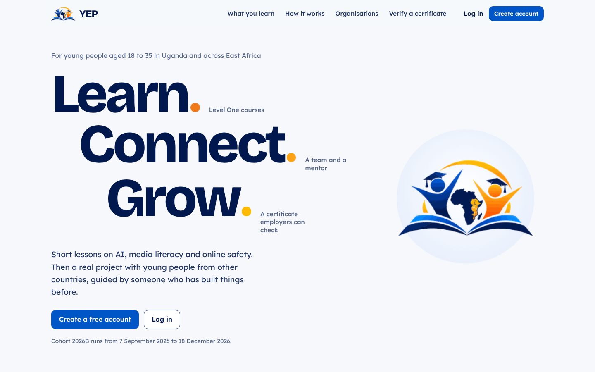
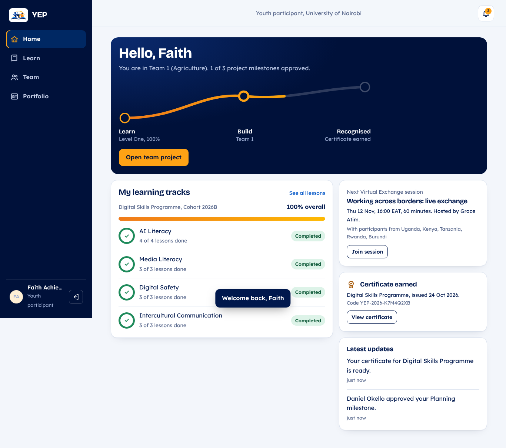
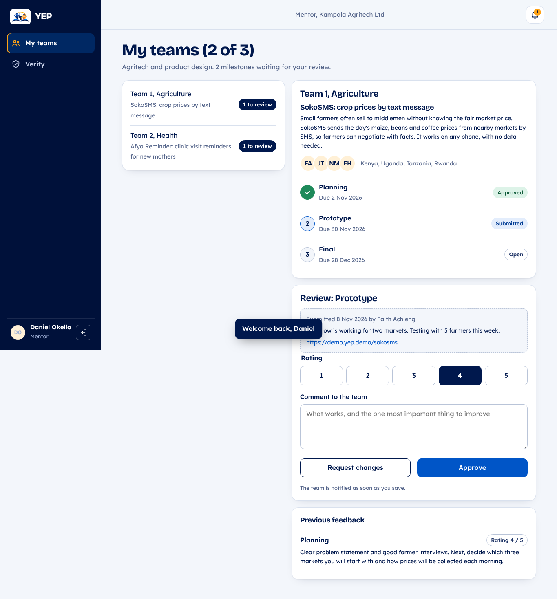
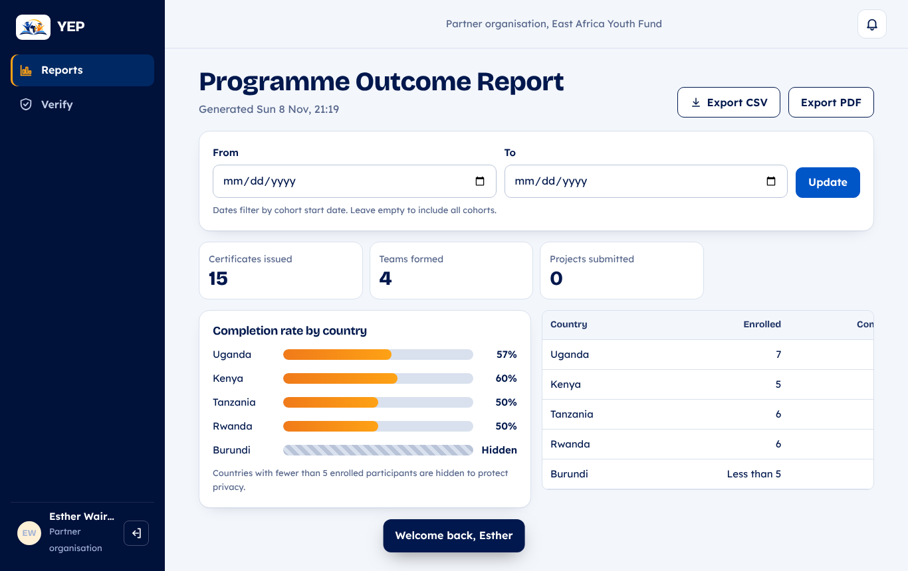

<div align="center">


# YEP

### Youth Digital Empowerment and Virtual Exchange Platform

*Learn. Build. Get recognised.*


Working prototype.

[Quick start](#quick-start) •
[Demo accounts](#demo-accounts) •
[Demo script](#suggested-5-minute-demo) •
[Architecture](#architecture) •
[OOP principles](#oop-principles) •
[License](#license)

</div>

---

## About

YEP is a web application written in **pure Java**, using only the standard library: no frameworks, nothing to download. The Java classes follow the group's **UML class diagram** and **pseudo-code**, and the screens follow the group's **13 wireframes**.

<div align="center">
  
</div>

## Screenshots

| Participant dashboard | Mentor review |
|:---:|:---:|
|  |  |
| **Partner report** | **Certificate** |
|  |  |

## Quick start

> [!NOTE]
> You need the **Java JDK 17 or newer**. Check with `java -version`.

| Platform | Command |
|---|---|
| **Windows** | Double-click `run.bat` |
| **macOS / Linux** | `./run.sh` |
| **Maven** | `mvn package` then `java -jar target/yep.jar` |
| **IntelliJ / Eclipse** | Open as a Maven project, set the working directory to the project folder, run `yep.Main` |

Then open **<http://localhost:8080>**. To use another port, pass it as an argument, e.g. `./run.sh 9090`.

> [!TIP]
> All data lives in memory. Every restart reloads the same demo data, so you can rehearse the demo as many times as you like.

## Deploy to Render

The repository includes a `Dockerfile` and a `render.yaml` Blueprint, so Render can build and run it without extra setup.

1. Push the project to GitHub (or GitLab).
2. In the Render dashboard choose **New > Blueprint**, pick the repository and confirm. Render reads `render.yaml` and creates a free Docker web service called `yep`.
   - Alternatively choose **New > Web Service**, pick the repository and set **Language** to **Docker**. Set the health check path to `/healthz`.
3. Wait for the build to finish, then open the `https://<name>.onrender.com` URL Render shows.

Render sets the `PORT` environment variable, and the app listens on it. Session cookies get the `Secure` flag automatically over HTTPS.

> [!NOTE]
> On the free plan the service sleeps after 15 minutes without visits; the first visit afterwards takes about a minute to wake it. Because data is kept in memory, every restart, redeploy or wake-up resets it to the demo data.

## Demo accounts

The login page has buttons that fill these in. Every password is **`Demo@2026`**.

| Account | Role | What to show |
|---|---|---|
| `amina@yep.demo` | Youth participant | Level One at 40%, lessons, AI assistant, quiz, portfolio |
| `faith@yep.demo` | Youth participant | Level Two team lead, submit the Prototype milestone |
| `grace@yep.demo` | Facilitator | Grade written tasks, form teams, add a lesson, moderate comments |
| `daniel@yep.demo` | Mentor | Review and approve milestones (has 2 of 3 teams) |
| `allan@yep.demo` | Employer | Talent search, view a portfolio, verify a certificate |
| `ruth@yep.demo` | University rep | Institution report for Cavendish University Uganda |
| `esther@yep.demo` | Partner organisation | Programme outcome report by country, CSV export |
| `admin@yep.demo` | Administrator | Approve 2 pending accounts, unlock a locked one, assign mentors, AI rules, audit log |

Demo certificate code: **`YEP-2026-K7M4Q2XB`** (check it under *Verify a certificate*).

## Suggested 5-minute demo

<details open>
<summary><b>Step-by-step walkthrough</b></summary>

1. **Landing page.** Open <http://localhost:8080> and explain the three steps: Learn, Build, Get recognised.
2. **Amina, the participant.** Show the dashboard and the journey path.
   - Open a lesson and turn the data saver on and off.
   - Ask the AI assistant *"How can I tell if a photo was made by AI? call me 0772123456"*. The phone number is removed and the answer is labelled as AI-generated.
   - Take the Digital Safety Quiz. It is marked automatically and the answers are explained.
3. **Grace, the facilitator.** Grade Amina's written task.
   - Go to Teams, select all eligible participants and press **Form teams**. Teams are mixed by country.
4. **Faith, the team lead.** Open Team, add a link and submit the Prototype milestone.
   - Try to submit Final first to show the rule *"Previous milestone must be approved first"*.
5. **Daniel, the mentor.** Rate the milestone, write a comment and approve it. Faith's team gets a notification.
6. **Allan, the employer.** Search for "data" and view a portfolio. Verify the demo certificate.
7. **Esther, the partner.** Show the outcome report. Countries with fewer than 5 participants are hidden for privacy. Export it as CSV.
8. **Paul, the administrator.** Approve Samuel Kiprono (Mentor) and unlock Rehema Said.
   - Assign Wanjiru to a team. Try giving Daniel a fourth team to show the limit of 3.
   - Open the audit log to show that every action above was recorded.

</details>

## Architecture

```text
yep-system/
├── src/main/java/yep/
│   ├── Main.java              Starts the server (PROGRAM YEP in the pseudo-code)
│   ├── model/                 Classes from the UML class diagram
│   ├── service/               Services from the pseudo-code
│   ├── data/
│   │   ├── DataStore.java     In-memory store with one list per ERD table
│   │   └── Seeder.java        Demo data: lessons, quizzes, 35 users, 3 teams
│   ├── util/                  Password hashing and exceptions
│   └── web/                   Small HTTP server and JSON API (JDK built-in HttpServer)
├── web/                       Front end: HTML, CSS and JavaScript screens
├── docs/screenshots/          Screenshots used in this README
├── pom.xml                    Maven build (no dependencies)
├── run.bat                    Windows launcher
└── run.sh                     macOS / Linux launcher
```

## OOP principles

| Principle | Where it appears |
|---|---|
| **Abstraction** | `User` and `OrganizationRepresentative` are abstract classes. |
| **Inheritance** | `YouthParticipant`, `Facilitator`, `Mentor`, `Administrator` extend `User`. `EmployerUser`, `UniversityRep`, `PartnerUser` extend `OrganizationRepresentative`. |
| **Polymorphism** | Each subclass overrides `getPermissions()`, `getRoleName()` and `getHomeView()`. `AuthService.checkPermission()` works for any user without knowing its type. `ReportService.getReport()` gives each role its own report. |
| **Interface** | `Scorable` (`getPercentage()`, `isPassed()`) is implemented by `Submission` and `ImpactProject`. |
| **Encapsulation** | All fields are private; changes go through methods like `Milestone.submit()`, `Enrollment.complete()`, `User.recordFailedLogin()`. Passwords are hashed with PBKDF2 and never stored or sent as plain text. |
| **Factory method** | `AuthService.createUserOfRole()` creates the right subclass for the chosen role. |

## Pseudo-code to Java

| Pseudo-code | Java |
|---|---|
| AuthService: registerUser, login, checkPermission, approveUser, logout | `service/AuthService.java` |
| LearningService: enrol, openLesson, postDiscussion, addContent | `service/LearningService.java` |
| AIAssistant.ask | `service/AIAssistant.java` |
| AssessmentService: submitAssessment, gradeSubmission, updateProgress | `service/AssessmentService.java` |
| CertificateService: issueCertificate, verifyCertificate | `service/CertificateService.java` |
| TeamService: listEligible, formTeams | `service/TeamService.java` |
| ProjectService: createProject, saveWork, submitMilestone | `service/ProjectService.java` |
| MentorshipService: assignMentor, giveFeedback, reviewMilestone | `service/MentorshipService.java` |
| PortfolioService: updatePortfolio, getPublicView, searchTalent | `service/PortfolioService.java` |
| ReportService: institutionReport, outcomeReport, systemReport, exportReport | `service/ReportService.java`, `model/Report.java` |

## Business rules enforced

<table>
<tr><td valign="top">

**Accounts & security**
- Passwords need at least 8 characters
- Youth participants must be aged 18–35
- Accounts lock after 5 wrong passwords
- Staff and organisation accounts need admin approval
- Sessions expire after 30 minutes of inactivity

**Learning & assessment**
- Enrol only once per track
- No submitting an assessment twice
- Pass mark is 50%
- Certificate issued automatically at 100%

</td><td valign="top">

**Teams & mentoring**
- At least 4 participants to form teams, max 6 per team
- Milestones must be approved in order
- A mentor can have at most 3 teams
- Ratings must be 1–5

**AI assistant & moderation**
- 30 questions per day
- Personal data is removed from questions
- Harmful questions are refused
- Turned off during assessments
- Comments with blocked words are rejected
- Countries with < 5 participants hidden in reports

</td></tr>
</table>

## Non-functional requirements

- **Branding:** official YEP logo, colours (navy `#00184D`, blue `#0055C7`, orange `#FEA215`, gold `#FEBA03`) and a favicon made from the logo symbol.
- **Mobile first:** a bottom tab bar on phones and a side menu on laptops.
- **Low data use:** gzip-compressed text responses, locally hosted fonts and images, and a lesson data saver that shows the video size before loading.
- **Offline drafts:** quiz answers and milestone drafts are saved in the browser.
- **Accessibility:** Lexend body text, visible keyboard focus, labelled form fields, good colour contrast, and reduced motion respected.
- **Audit log:** logins, approvals, grading, team changes and exports are all recorded.

## Prototype limitations

> [!IMPORTANT]
> - **Data** is stored in memory, not in a database. `DataStore` is the only class that would change to use PostgreSQL or MySQL with the ERD tables.
> - **The AI assistant** does not call an outside AI model. It searches the YEP lesson library offline and answers from it, while still applying all the safety rules from the pseudo-code.
> - **Not included:** lesson videos, live session links and team chat show placeholders.

## License

This project is licensed under the [MIT License](LICENSE).

---

<div align="center">
<sub>Built for the OOP Using Java course · Cavendish University Uganda · 2026</sub>
</div>
